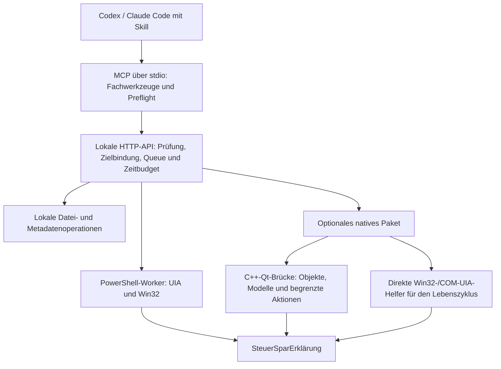

# SteuerSparErklärung für KI-Assistenten

[](https://github.com/yadimon/steuer-spar-erklaerung-mcp/actions/workflows/windows-ci.yml)

Das inoffizielle Agent Plugin lässt Codex oder Claude Code eine lokal geöffnete
SteuerSparErklärung 2025 prüfen, mit Belegen abgleichen und nach ausdrücklicher
Freigabe kontrolliert bearbeiten. Skill, MCP, API, PowerShell-/Native-Runtime,
Profile und JavaScript-Dependencies kommen gemeinsam in einer
versionsgleichen Installation.

> **Öffentliche Beta für Windows x64.** Das Projekt ist keine Steuerberatung.
> Ergebnisse selbst prüfen und den aktuellen Dateistand vor der ersten
> Änderung privat sichern.


Ein Auftrag in einem Satz: vier neue Eingangsrechnungen aus einem Belegordner
als Betriebsausgaben eintragen, jede auf ihre Kostenart, speichern — und zum
Schluss die Umsatzsteuer-Voranmeldung zeigen. Nichts wird an ELSTER gesendet.

## Was kann es?

- den eindeutig geöffneten Fall in SteuerSparErklärung 2025 lesen und mit dem
  Programm-Prüfer untersuchen;
- bestätigte Belegquellen inventarisieren und mit dem Fall abgleichen;
- Felder und Tabellen eng gebunden ändern und unmittelbar zurücklesen;
- Umsatzsteuer-Voranmeldungen vorbereiten, ohne sie zu übermitteln;
- Berichte, private Backups und ausdrücklich verlangte Arbeitskopien im lokalen
  Arbeitsbereich erzeugen;
- über `sse_preflight` Arbeitsbereich, Produktprofil und Laufzeit prüfen, bevor
  Steuerdaten gelesen werden;
- einen neuen Gewinn-Erfassungsfall des freigegebenen Folgejahres über den
  echten Startassistenten anlegen (`sse_case_create`) und dessen Stammdaten
  über katalogisierte Seiten füllen.

Profil 2025 / Engine 31 ist freigegeben. Profil 2024 bleibt experimentell und
auf Verifikation begrenzt. `GewErfass2026` ist ausschließlich für den belegten
Folgejahr-Leseweg und die neu angelegte Gewinn-Erfassung freigegeben. Im
BelegManager ist allgemein nur die Leseliste ohne Vordergrundbedienung aktiv.
Die neun weiteren BelegManager-Operationen sind im normalen API-/MCP-Betrieb
gesperrt, auch wenn dafür bereits interne Qt-Implementierungen bestehen.

## Voraussetzungen und harte Grenzen

- Windows x64, Node.js 22 oder neuer, Git auf `PATH` für das einmalige Klonen
  des Plugin-Repositories durch `plugins@1.3.4` und eine installierte
  SteuerSparErklärung 2025;
- ein lokal laufender Codex- oder Claude-Code-Client auf demselben PC;
- für sichtbare Bedienung eine entsperrte, unbenutzte Windows-Sitzung.

Der Agent sendet nichts über ELSTER, speichert nie automatisch und bearbeitet
keinen unklaren Fall. Ein bereits eindeutig geöffneter Fall gewinnt. Originale
und übermittelte Fälle werden nicht still ersetzt, verschoben oder gelöscht.
Save As und Arbeitskopien sind keine impliziten Sicherheitsmaßnahmen. Vor der
ersten dirty-fähigen Navigation oder Änderung wird der aktuelle Dateistand
hashgebunden gesichert; jede Änderung braucht Readback und Speichern einen
eigenen ausdrücklichen Auftrag.

## Schnellstart

Erstelle einen leeren Auftragsordner und verwende genau die Strecke für deinen
Client. Die automatische Clienterkennung von `plugins@1` wird unter Windows
nicht empfohlen.

### Codex

```powershell
mkdir steuer-auftrag
cd steuer-auftrag
npx -y plugins@1 add yadimon/steuer-spar-erklaerung-mcp --target codex --scope project --yes
codex plugin add steuer-spar-erklaerung@plugins-cli --json
```

Zur dokumentierten Installationsstrecke mit `plugins@1.3.4` gehören beide
Codex-Befehle: Der erste registriert Cache und Marketplace, der zweite
installiert das Plugin im Client. Ein Status `not installed` ist noch kein
erfolgreicher Abschluss; erwartet wird `installed, enabled`. Prüfe das mit
`codex plugin list --json`. Diese Statusabfrage ersetzt keinen
Installationsschritt und kann abhängig von der Clientversion selbst
Cache-/Konfigurationszustand materialisieren.

### Claude Code

```powershell
mkdir steuer-auftrag
cd steuer-auftrag
npx -y plugins@1 add yadimon/steuer-spar-erklaerung-mcp --target claude-code --scope user --yes
```

Claude Code benötigt keinen zusätzlichen Codex-Befehl: Der Eintrag steht nach
diesem einen Installeraufruf als `enabled`, und die target-native Entfernung
gelingt mit demselben User-Scope.
Danach den gewählten Client im Ordner `steuer-auftrag` neu starten oder
seine Plugins neu laden. Git wird nur vom einmaligen Installer zum Klonen
benötigt. Zur Laufzeit ist Node.js 22+ die einzige zusätzliche Voraussetzung:
Es ist kein `npm install`, kein separates API-Terminal und kein weiterer
Runtime-Download nötig. Beim MCP-Start laufen weder npm noch npx und es wird
kein Netzwerkzugriff benötigt.

`plugins@1.3.4` ignoriert den Scope bei Codex und schreibt bei beiden Zielen in
clientverwaltete Benutzer-Caches beziehungsweise Benutzerkonfiguration. Beim
Claude-Code-Ziel ist `--scope user` absichtlich gewählt: Ein vom Installer als
`project` registrierter Zustand ist target-nativ nicht entfernbar, `user`
dagegen vollständig lesbar und entfernbar.
Damit gibt es keine physische Projektisolation. Der geöffnete Ordner begrenzt
weiterhin den Auftragskontext; für strikt getrennte Arbeitsdaten wird
zusätzlich ein eigener absoluter `SSE_API_CONFIG`-Pfad konfiguriert. Details,
Update und sichere Entfernung stehen in der
[Installationsanleitung](docs/INSTALLATION.md).

## Erster Auftrag

Der Plugin-Skill führt als kurzer First-run-Wizard durch den Start:

1. Er merkt sich den ursprünglichen Auftrag und ruft `sse_preflight` auf.
2. Er stellt höchstens eine Frage pro Nachricht. Ein bereits eindeutig
   geöffneter Fall wird nicht erneut ausgewählt; andernfalls bestätigt der
   Nutzer Fall und vollständige Belegquellen.
3. Der Agent zeigt einen sicheren Plan: zunächst lesen, vor dirty-fähiger
   Bedienung einmal sichern, Änderungen zurücklesen, nicht speichern und nie
   über ELSTER senden.
4. Nach der Bestätigung setzt er den ursprünglichen Auftrag fort.

Zum Beispiel:

```text
Prüfe den bereits geöffneten Steuerfall und erkläre Fehler, Warnungen und
unklare Angaben. Speichere und schließe ihn nicht.
```

```text
Vergleiche den geöffneten Fall mit allen Belegen in <BELEGORDNER>.
Frage nach, falls diese Quellen nicht vollständig erscheinen.
```

```text
Ändere im geöffneten Fall <FELD> auf <WERT>. Sichere den aktuellen Dateistand
vorher einmal, lies die Änderung zurück und speichere noch nicht.
```

```text
Bereite meine UStVA für <ZEITRAUM> aus den bestätigten Rechnungen vor.
Speichere nicht und sende nichts über ELSTER.
```

## Komponenten



Der MCP-Supervisor übernimmt nur eine exakt passende API-Identität oder startet
die mitgelieferte API unsichtbar. Fremde Dienste, alte Versionen und unklare
Portinhaber stoppen fail-closed und werden nie automatisch beendet.

### Warum die Umstellung auf Qt?

Viele Formulare und Tabellen beruhen auf Qt. Die optionale C++-Brücke kann
Werte und Tabellenmodelle direkt im gebundenen Produktprozess lesen und
bestimmte Aktionen quittiert ausführen. Damit sollen wiederholte UIA-Baumläufe,
zusätzliche Workerstarts und unnötige Fokuswechsel vermieden werden.

Die Umstellung erfolgt je Operation. Ein passendes natives Paket muss separat
gebaut und über `qtNativeRuntime` konfiguriert sein. Die normale
Plugin-Installation aktiviert die Qt-Brücke nicht automatisch. Dateiarbeit,
Speichern, Dialoge und nicht umgestellte Operationen behalten ihre jeweils
vorgesehenen Ausführungswege. Die C#-Helfer des Workers sind keine Qt-Brücke.

Ein nativer Handler allein beweist weder vollständige Live-Abdeckung noch
eine feste Antwortzeit. Nach einem unklaren Schreibausgang wird kein anderer
Backendweg ausprobiert. Zweck, Umstellungsprozess und Nachweisgrenzen stehen
in [Architektur](docs/ARCHITEKTUR.md), [Qt-Vertrag](docs/NATIVE-QT.md) und
[Native-Matrix](docs/NATIVE-COVERAGE.md).

Die direkte Installation der
[`@yadimon/steuer-spar-erklaerung-api`](packages/api/README.md) oder des
[`@yadimon/steuer-spar-erklaerung-mcp`](packages/mcp/README.md) bleibt als
fortgeschrittener npm-Weg verfügbar, ist aber nicht der Nutzerstandard.

## Dokumentation

- [Installation, First run, Update und Entfernung](docs/INSTALLATION.md)
- [Dokumentationsindex](docs/README.md)
- [Produktarchitektur](docs/ARCHITEKTUR.md)
- [API-/MCP-Vertrag](docs/API-MCP-VERTRAG.md)
- [Umsatzsteuer-Voranmeldung](docs/UMSATZSTEUER-VORANMELDUNG.md)
- [Verifikationsstand](docs/VERIFIKATION.md)
- [Fortschritt der Qt-DLL-Integration](docs/NATIVE-COVERAGE.md)
- [Skill-Vertrag](skills/steuer-spar-erklaerung/SKILL.md)
- [Entwicklungsprozess und offene Qualitätsziele](PROGRESS.md)
- [Releases](https://github.com/yadimon/steuer-spar-erklaerung-mcp/releases)

## Mitwirken

```powershell
npm run test:inventory
npm ci --ignore-scripts
```

Das Inventar zeigt nur den Testplan und startet keine Tests. Voraussetzungen,
passende Prüfungen und der PR-Prozess stehen in [CONTRIBUTING.md](CONTRIBUTING.md).
Auch die schnelle Suite enthält Windows-Helferprüfungen. Produkt- und
GUI-Läufe benötigen die dort beschriebenen Voraussetzungen und eine eigene
Freigabe. Änderungen an `main` gehen über einen PR mit erfolgreicher Windows-CI.

Niemals echte Steuerfälle, Belege, Namen, Steuer-IDs, Tokens, lokale Pfade oder
ungeschwärzte Screenshots veröffentlichen. Sicherheitsprobleme bitte privat
über [Report a vulnerability](SECURITY.md) melden.

Lizenz: [MIT](LICENSE)
