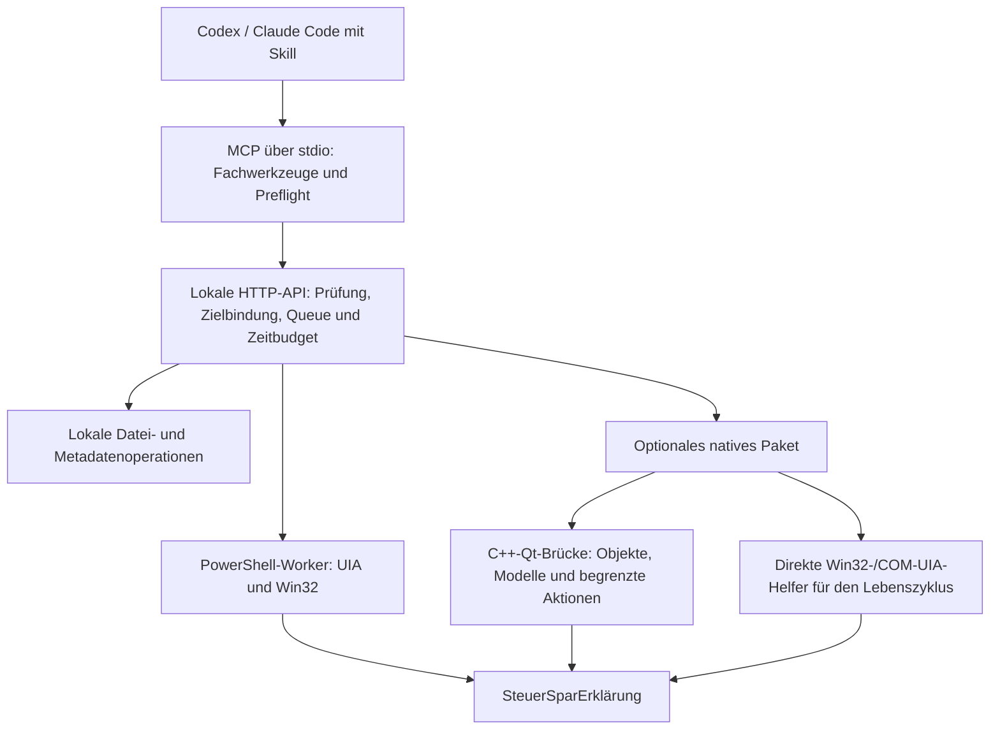

# SteuerSparErklärung für KI-Assistenten

[](https://github.com/yadimon/steuer-spar-erklaerung-mcp/actions/workflows/windows-ci.yml)

Die inoffizielle MCP-/API-Integration lässt Codex oder Claude Code eine lokal
geöffnete SteuerSparErklärung 2025 prüfen, mit Belegen abgleichen und nach
ausdrücklicher Freigabe kontrolliert bearbeiten. Für Codex werden MCP und API
über npm installiert und der sichere Arbeitsablauf als separater Skill geladen.
Claude Code kann weiterhin das selbstenthaltene Agent Plugin verwenden.

> **Öffentliche Beta für Windows x64.** Das Projekt ist keine Steuerberatung.
> Ergebnisse selbst prüfen und den aktuellen Dateistand vor der ersten
> Änderung privat sichern.


Ein Auftrag in einem Satz: vier neue Eingangsrechnungen aus einem Belegordner
als Betriebsausgaben eintragen, jede auf ihre Kostenart, speichern — und zum
Schluss die Umsatzsteuer-Voranmeldung zeigen. Nichts wird an ELSTER gesendet.

## Was kann es?

- den eindeutig geöffneten Fall in SteuerSparErklärung 2025 lesen und mit dem
  Programm-Prüfer untersuchen;
- bestätigte Belegquellen inventarisieren und mit dem Fall abgleichen;
- Felder und Tabellen eng gebunden ändern und unmittelbar zurücklesen;
  beim Löschen den gesamten ausgelesenen Restbestand prüfen und ungewisse
  Ergebnisse ausdrücklich melden;
- Umsatzsteuer-Voranmeldungen vorbereiten, ohne sie zu übermitteln;
- Berichte, private Backups und ausdrücklich verlangte Arbeitskopien im lokalen
  Arbeitsbereich erzeugen;
- über `sse_preflight` Arbeitsbereich, Produktprofil und Laufzeit prüfen, bevor
  Steuerdaten gelesen werden;
- einen neuen Gewinn-Erfassungsfall des freigegebenen Folgejahres über den
  echten Startassistenten anlegen (`sse_case_create`) und dessen Stammdaten
  über katalogisierte Seiten füllen.

Bei Startfragen oder unklaren Startzuständen hält die Fallanlage an und erhält
den Prozess zur Prüfung. Rückfragen werden nicht automatisch beantwortet.

Profil 2025 / Engine 31 ist freigegeben. Profil 2024 bleibt experimentell und
auf Verifikation begrenzt. `GewErfass2026` ist ausschließlich für den belegten
Folgejahr-Leseweg und die neu angelegte Gewinn-Erfassung freigegeben. Im
BelegManager ist allgemein nur die Leseliste ohne Vordergrundbedienung aktiv.
Die neun weiteren BelegManager-Operationen sind im normalen API-/MCP-Betrieb
gesperrt, auch wenn dafür bereits interne Qt-Implementierungen bestehen.

## Voraussetzungen und harte Grenzen

- Windows x64, Node.js 22 oder neuer und eine installierte SteuerSparErklärung 2025;
- Git auf `PATH` nur für den einmaligen Plugin-Installer `plugins@1.3.4`;
- ein lokal laufender Codex- oder Claude-Code-Client auf demselben PC;
- für sichtbare Bedienung eine entsperrte, unbenutzte Windows-Sitzung.

Der Agent sendet nichts über ELSTER, speichert nie automatisch und bearbeitet
keinen unklaren Fall. Ein bereits eindeutig geöffneter Fall gewinnt. Originale
und übermittelte Fälle werden nicht still ersetzt, verschoben oder gelöscht.
Save As und Arbeitskopien sind keine impliziten Sicherheitsmaßnahmen. Vor der
ersten dirty-fähigen Navigation oder Änderung wird der aktuelle Dateistand
hashgebunden gesichert; jede Änderung braucht Readback und Speichern einen
eigenen ausdrücklichen Auftrag.

Der Originalfall ist der normale Arbeitsfall. Eine frühere Übermittlung sperrt
ihn nicht pauschal für weitere Zeiträume. Klar beauftragte Änderungen und
Speichern sind nach Sicherung auch im Original erlaubt; „ändere und speichere“
genügt als gemeinsamer Auftrag. Bereits erteilte Freigaben werden weiterverwendet.

## Schnellstart

**Codex: Plugin-Installation vorläufig nicht empfohlen.** Codex begrenzt die
Metadaten von MCP-Werkzeugen aus Agent Plugins auf insgesamt **64 000 Bytes**.
Bei beta55 wurde dadurch ein Katalog mit **26 von 104** verfügbaren Werkzeugen
reproduziert; auch `sse_preflight` kann fehlen. Die Empfehlung der
Plugin-Installation für Codex ist deshalb vorübergehend ausgesetzt.
Direkt registrierte npm-MCP-Verbindungen sind von diesem Plugin-Budget nicht
betroffen. Das ist eine Grenze dieses Codex-Integrationswegs, keine allgemeine
Aussage über API, MCP oder andere Clients. Siehe
[Codex-Quellcode](https://github.com/openai/codex/blob/main/codex-rs/core/src/mcp_tool_exposure.rs)
und [bekannte Meldung](https://github.com/openai/codex/issues/49758).

### Codex

Für Codex ist das direkte npm-MCP mit automatisch installierter API derselben
Version derzeit der empfohlene Weg. Installiere die Runtime auf einem lokalen,
nicht synchronisierten Laufwerk; der Auftragsordner mit den Belegen darf
getrennt liegen.

Das folgende Beispiel ist für eine neue Installation. Eine vorhandene
Plugin-Verbindung zuerst nach dem
[Umstellungsweg](docs/INSTALLATION.md#vorhandenes-codex-plugin-umstellen)
deaktivieren und ihre bisherigen Datenbindungen erhalten.

```powershell
$RuntimeRoot = Join-Path $env:USERPROFILE '.local\share\SteuerSparErklaerungMcp'
New-Item -ItemType Directory -Force -Path $RuntimeRoot | Out-Null
Set-Location $RuntimeRoot
npm.cmd init -y
npm.cmd install --save-exact @yadimon/steuer-spar-erklaerung-mcp@latest

$Node = (Get-Command node -CommandType Application | Select-Object -First 1).Source
$Mcp = Join-Path $RuntimeRoot 'node_modules\@yadimon\steuer-spar-erklaerung-mcp\dist\index.js'
$ApiConfig = Join-Path $RuntimeRoot 'sse-api-config.json'
codex mcp add steuer-spar-erklaerung --env "SSE_API_CONFIG=$ApiConfig" -- $Node $Mcp
```

npm installiert die API als exakt versionsgleiche Dependency. Der MCP startet
sie bei Bedarf im Hintergrund. Für Codex unter Windows die API vor dem
Fachauftrag in einem eigenen Terminal starten, damit ihr Prozessbaum vom
Ende der MCP-Verbindung unabhängig bleibt. Der genaue Befehl steht in der
[Installationsanleitung](docs/INSTALLATION.md#api-lebensdauer-bei-codex-unter-windows).
Beim MCP-Start laufen weder npm noch npx und es ist kein Netzwerkzugriff nötig.
Vorhandene Datenbindungen in einer bestehenden API-Konfiguration beibehalten.

Installiere den [Skill](skills/steuer-spar-erklaerung/SKILL.md) separat über den
Skill Installer von Codex aus diesem Repository (Pfad
`skills/steuer-spar-erklaerung`). Starte danach eine neue Sitzung im
gewünschten Auftragsordner und prüfe den echten Aufruf von `sse_preflight`
sowie die Verfügbarkeit von `sse_instances` und des vollständigen Katalogs.
Die [Installationsanleitung](docs/INSTALLATION.md) beschreibt Datenablage,
Skill-Installation und die Umstellung eines vorhandenen Plugins.

### Claude Code

```powershell
mkdir steuer-auftrag
cd steuer-auftrag
npx -y plugins@1 add yadimon/steuer-spar-erklaerung-mcp --target claude-code --scope user --yes
```

Claude Code benötigt keinen zusätzlichen Codex-Befehl: Der Eintrag steht nach
diesem einen Installeraufruf als `enabled`, und die target-native Entfernung
gelingt mit demselben User-Scope.
Danach Claude Code im Auftragsordner neu starten oder seine Plugins neu laden.
Die automatische Clienterkennung von `plugins@1` ist unter Windows nicht empfohlen.
Der Plugin-Installer benötigt Git einmalig; beim MCP-Start laufen weder npm
noch npx und es ist kein Netzwerkzugriff nötig. Claude Code verwendet bewusst
den User-Scope. `plugins@1.3.4` ignoriert den Scope bei Codex; eine
Plugin-Registrierung bedeutet dort keine physische Projektisolation.
Getrennte Arbeitsdaten werden über einen absoluten `SSE_API_CONFIG`-Pfad
gebunden. Weitere Schritte stehen in der [Installationsanleitung](docs/INSTALLATION.md).

## Erster Auftrag

Der separat installierte oder mitgelieferte Skill führt als kurzer First-run-Wizard durch den Start:

1. Er merkt sich den ursprünglichen Auftrag und ruft `sse_preflight` auf.
2. Er stellt höchstens eine Frage pro Nachricht. Ein bereits eindeutig
   geöffneter Fall wird nicht erneut ausgewählt; andernfalls bestätigt der
   Nutzer Fall und vollständige Belegquellen.
3. Der Agent zeigt einen sicheren Plan: zunächst lesen, vor dirty-fähiger
   Bedienung einmal sichern, Änderungen zurücklesen und nur auf Auftrag
   speichern. Über ELSTER wird niemals gesendet.
4. Er setzt den ursprünglichen Auftrag im freigegebenen Umfang fort und
   verwendet bereits erteilte Freigaben weiter.

Zum Beispiel:

```text
Prüfe den bereits geöffneten Steuerfall und erkläre Fehler, Warnungen und
unklare Angaben. Speichere und schließe ihn nicht.
```

```text
Vergleiche den geöffneten Fall mit allen Belegen in <BELEGORDNER>.
Frage nach, falls diese Quellen nicht vollständig erscheinen.
```

```text
Ändere im geöffneten Fall <FELD> auf <WERT>. Sichere den aktuellen Dateistand
vorher einmal, lies die Änderung zurück und speichere noch nicht.
```

```text
Bereite meine UStVA für <ZEITRAUM> aus den bestätigten Rechnungen vor.
Speichere nicht und sende nichts über ELSTER.
```

## Komponenten



Der MCP-Supervisor übernimmt nur eine exakt passende API-Identität oder startet
die mitgelieferte API unsichtbar. Fremde Dienste, alte Versionen und unklare
Portinhaber stoppen fail-closed und werden nie automatisch beendet.

### Warum die Umstellung auf Qt?

Viele Formulare und Tabellen beruhen auf Qt. Die optionale C++-Brücke kann
Werte und Tabellenmodelle direkt im gebundenen Produktprozess lesen und
bestimmte Aktionen quittiert ausführen. Damit sollen wiederholte UIA-Baumläufe,
zusätzliche Workerstarts und unnötige Fokuswechsel vermieden werden.

Die Umstellung erfolgt je Operation. Ein passendes natives Paket muss separat
gebaut und über `qtNativeRuntime` konfiguriert sein. Die normale
Plugin-Installation aktiviert die Qt-Brücke nicht automatisch. Dateiarbeit,
Speichern, Dialoge und nicht umgestellte Operationen behalten ihre jeweils
vorgesehenen Ausführungswege. Die C#-Helfer des Workers sind keine Qt-Brücke.

Ein nativer Handler allein beweist weder vollständige Live-Abdeckung noch
eine feste Antwortzeit. Nach einem unklaren Schreibausgang wird kein anderer
Backendweg ausprobiert. Zweck, Umstellungsprozess und Nachweisgrenzen stehen
in [Architektur](docs/ARCHITEKTUR.md), [Qt-Vertrag](docs/NATIVE-QT.md) und
[Native-Matrix](docs/NATIVE-COVERAGE.md).

Die Stabilisierung gilt auch für den normalen UIA-Pfad: Tabellenänderungen
prüfen das vollständige Modell und den Nachzustand, Beleglisten behalten
verborgene Spalten in ihrer Bindung; das gilt auch für den optionalen Qt-Pfad.
Ein bewusst geöffnetes Menü bleibt für
den nächsten Aufruf offen. Bei verlorener Eingabebindung oder unbekanntem
Schreibausgang folgt kein automatischer zweiter Schreibversuch. Die Grenzen
und die getrennten Offline-, Live- und Dauerprüfungen beschreibt die
[Verifikation](docs/VERIFIKATION.md).

Das [npm-MCP-Paket](packages/mcp/README.md) mit seiner exakt versionsgleichen
API-Dependency ist der empfohlene Codex-Einstieg. Das
[API-Paket](packages/api/README.md) bleibt für eigene HTTP-/CLI-Integrationen
separat installierbar.

## Dokumentation

- [Installation, First run, Update und Entfernung](docs/INSTALLATION.md)
- [Dokumentationsindex](docs/README.md)
- [Produktarchitektur](docs/ARCHITEKTUR.md)
- [API-/MCP-Vertrag](docs/API-MCP-VERTRAG.md)
- [Umsatzsteuer-Voranmeldung](docs/UMSATZSTEUER-VORANMELDUNG.md)
- [Verifikationsstand](docs/VERIFIKATION.md)
- [Kriterien und Prüfschritte für einen stabilen Release](docs/entwicklung/stable-freigabe.md)
- [Fortschritt der Qt-DLL-Integration](docs/NATIVE-COVERAGE.md)
- [Skill-Vertrag](skills/steuer-spar-erklaerung/SKILL.md)
- [Entwicklungsprozess und offene Qualitätsziele](PROGRESS.md)
- [Releases](https://github.com/yadimon/steuer-spar-erklaerung-mcp/releases)

## Mitwirken

```powershell
npm run test:inventory
npm ci --ignore-scripts
```

Das Inventar zeigt nur den Testplan und startet keine Tests. Voraussetzungen,
passende Prüfungen und der PR-Prozess stehen in [CONTRIBUTING.md](CONTRIBUTING.md).
Auch die schnelle Suite enthält Windows-Helferprüfungen. Produkt- und
GUI-Läufe benötigen die dort beschriebenen Voraussetzungen und eine eigene
Freigabe. Änderungen an `main` gehen über einen PR mit erfolgreicher Windows-CI.

Niemals echte Steuerfälle, Belege, Namen, Steuer-IDs, Tokens, lokale Pfade oder
ungeschwärzte Screenshots veröffentlichen. Sicherheitsprobleme bitte privat
über [Report a vulnerability](SECURITY.md) melden.

Lizenz: [MIT](LICENSE)
